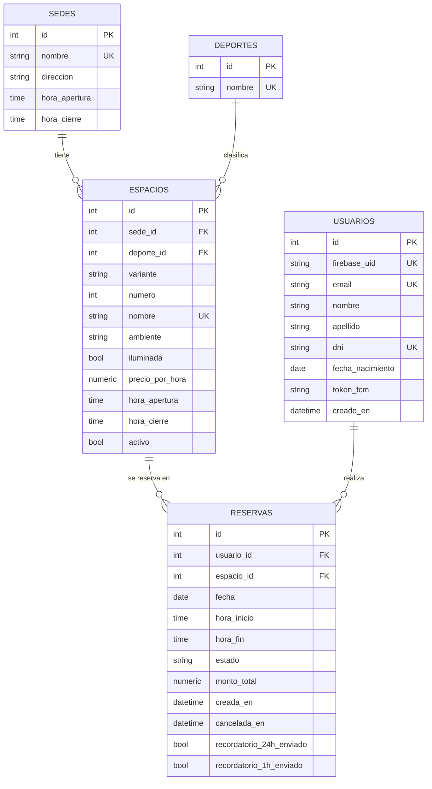

# Modelo de datos

Base de datos relacional en **PostgreSQL**. Las tablas están definidas con SQLAlchemy en `backend/app/models.py` y se crean con `backend/cargar_datos.py`.

## Diagrama entidad-relación

PK: clave primaria. FK: clave foránea. UK: valor único.

## Entidades

### usuarios
Persona registrada en la app. La contraseña **no** se guarda acá: la maneja Firebase Authentication.

| Atributo | Tipo | Descripción |
|---|---|---|
| id | entero, PK | Identificador |
| firebase_uid | texto, único | Identificador de la cuenta en Firebase. Une esta tabla con Firebase |
| email | texto, único | Se toma del token de Firebase y no se puede editar |
| nombre, apellido | texto | |
| dni | texto, único | 7 u 8 dígitos |
| fecha_nacimiento | fecha | Anterior a hoy |
| token_fcm | texto, opcional | Token del celular para las notificaciones push |
| creado_en | fecha y hora | Se completa automáticamente |

### sedes
Predio del club, con su horario de funcionamiento (igual todos los días).

| Atributo | Tipo | Descripción |
|---|---|---|
| id | entero, PK | |
| nombre | texto, único | Ej: Morón |
| direccion | texto | Ej: Av. Rivadavia 17500 |
| hora_apertura, hora_cierre | hora | La apertura tiene que ser anterior al cierre |

### deportes
Tipo de espacio deportivo. Es el filtro por tipo que pide la consigna.

| Atributo | Tipo | Descripción |
|---|---|---|
| id | entero, PK | |
| nombre | texto, único | Fútbol, Tenis, Hockey, Vóley, Golf |

### espacios
Cancha concreta dentro de una sede.

| Atributo | Tipo | Descripción |
|---|---|---|
| id | entero, PK | |
| sede_id | FK a sedes | |
| deporte_id | FK a deportes | |
| variante | texto | Modalidad: Fútbol 5, Polvo de Ladrillo, etc. |
| numero | entero | Número de cancha dentro de la misma sede, deporte y variante |
| nombre | texto, único | Sede, dirección, tipo y número. Ej: `Moron_Rivadavia_17500_Futbol_F5_1` |
| ambiente | texto | Indoor u Outdoor |
| iluminada | booleano | |
| precio_por_hora | numérico (10,2) | Mayor a 0 |
| hora_apertura, hora_cierre | hora | Horario propio de la cancha, siempre dentro del de la sede |
| activo | booleano | Si se puede reservar |

### reservas
Reserva de un espacio para una fecha y un rango de horas completas.

| Atributo | Tipo | Descripción |
|---|---|---|
| id | entero, PK | |
| usuario_id | FK a usuarios | Se borra si se elimina la cuenta (ON DELETE CASCADE) |
| espacio_id | FK a espacios | |
| fecha | fecha | |
| hora_inicio, hora_fin | hora | En punto, y el fin posterior al inicio |
| estado | texto | `activa` o `cancelada` |
| monto_total | numérico (10,2) | Precio por hora por cantidad de horas, al momento de reservar |
| creada_en | fecha y hora | |
| cancelada_en | fecha y hora, opcional | Cuándo se canceló |
| recordatorio_24h_enviado, recordatorio_1h_enviado | booleano | Para no enviar dos veces el mismo recordatorio push |

## Relaciones

- **sedes → espacios** (1 a N): una sede tiene muchos espacios; cada espacio pertenece a una sede.
- **deportes → espacios** (1 a N): un deporte tiene muchos espacios; cada espacio es de un deporte.
- **espacios → reservas** (1 a N): un espacio tiene muchas reservas a lo largo del tiempo; cada reserva es de un espacio.
- **usuarios → reservas** (1 a N): un usuario tiene muchas reservas; cada reserva es de un usuario.

## Restricciones en la base

Además de las validaciones del backend, la base rechaza datos inválidos:

- Valores únicos: email, DNI y firebase_uid de usuarios; nombre de sedes, deportes y espacios.
- Una cancha no se repite dentro de la misma sede, deporte, variante y número.
- Horarios de sedes y canchas: apertura anterior al cierre.
- Reservas: horas en punto, fin posterior al inicio, estado `activa` o `cancelada`.
- Precio mayor a 0 y ambiente Indoor u Outdoor.
- Índice por espacio y fecha en reservas, para consultar rápido la disponibilidad.

## Decisiones de diseño

- **Las contraseñas no están en la base**: las maneja Firebase. La tabla guarda el `firebase_uid` para relacionar la cuenta con el perfil.
- **Dinero en `numeric` y no en `float`**: evita errores de redondeo.
- **El monto se guarda en la reserva**: si cambia el precio de la cancha, las reservas ya hechas conservan el suyo.
- **"Completada" no se guarda**: se calcula comparando el horario con la hora actual. Guardarlo obligaría a actualizarlo constantemente.
- **Cancelar no borra**: la reserva queda en el historial como cancelada y el horario se libera, porque la disponibilidad solo cuenta reservas activas.
- **Claves primarias numéricas**: simples de leer y suficientes para este sistema.
