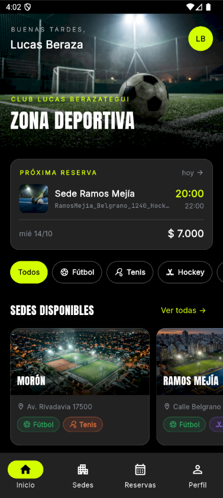
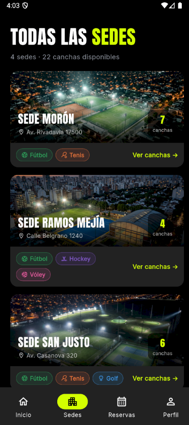
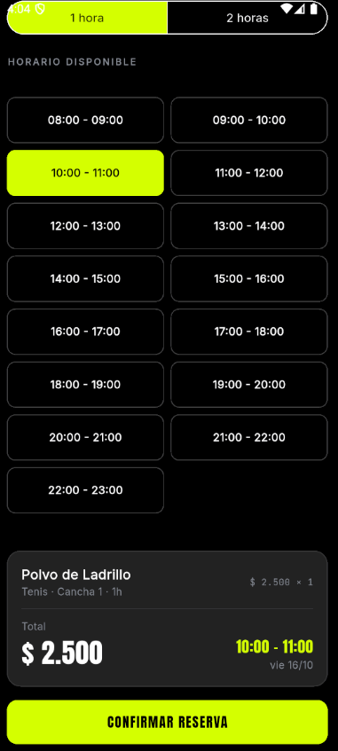
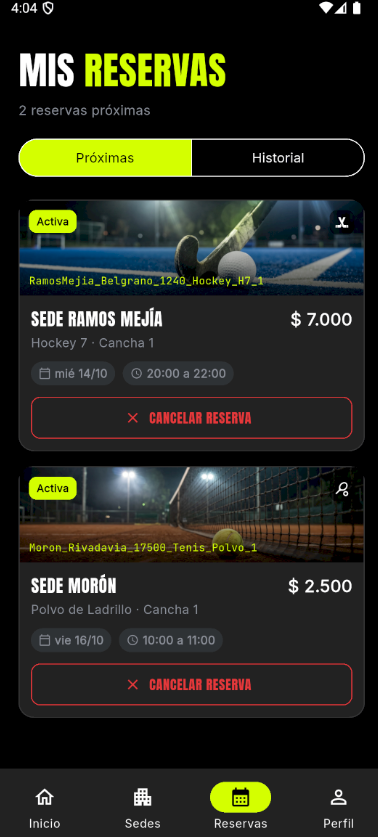
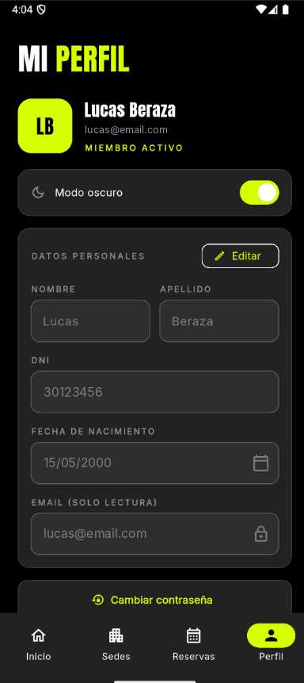
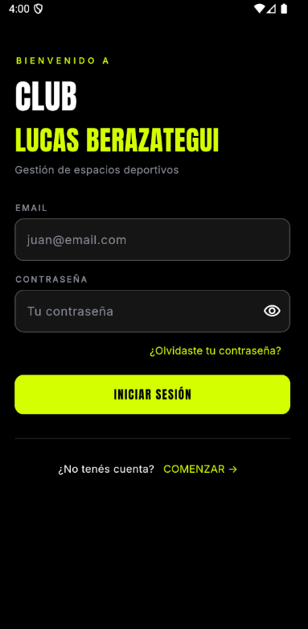

# App ClubLucasBerazategui

Aplicación móvil (Android) del club, hecha con **Flutter**. Se conecta a la API REST de la carpeta `backend` y usa **Firebase Authentication** para el inicio de sesión.

| Inicio | Sedes | Reservar |
|---|---|---|
|  |  |  |

| Mis reservas | Perfil | Login |
|---|---|---|
|  |  |  |

## Qué se puede hacer

- **Cuenta:** registrarse (nombre, apellido, DNI, fecha de nacimiento, email y contraseña), iniciar sesión y recuperar la contraseña por email.
- **Inicio:** saludo, próxima reserva, filtro por deporte y las sedes disponibles.
- **Sedes:** las 4 sedes con su dirección y horario. Dentro de cada una, sus canchas filtradas por deporte y por tipo.
- **Reservar:** elegir cancha, día (los próximos 7), duración (1 o 2 horas) y un horario libre. Los ocupados aparecen tachados. Muestra el total antes de confirmar.
- **Mis reservas:** próximas (se pueden cancelar) e historial completo, con su estado: activa, completada o cancelada.
- **Perfil:** ver y editar los datos (el email no se puede cambiar), modo claro u oscuro, cambiar la contraseña, cerrar sesión y eliminar la cuenta (pide la contraseña).

## Requisitos

- **Flutter** 3.x (con Dart 3.13 o superior). Verificar con `flutter doctor`.
- **Android Studio** con un emulador de Android creado (Device Manager).
- El **backend corriendo** (ver [../backend/README.md](../backend/README.md)), en la PC o en Render.
- El mismo **proyecto de Firebase** que usa el backend, con Authentication habilitado (proveedor Email/Contraseña).

## 1. Instalar las dependencias

Desde la carpeta `app`:

```
flutter pub get
```

## 2. Configurar Firebase

La app necesita dos archivos que **no están en GitHub**, porque identifican al proyecto de Firebase:

- `android/app/google-services.json`
- `lib/firebase_options.dart`

Se generan con FlutterFire CLI (hace falta tener Node.js para el Firebase CLI):

```
npm install -g firebase-tools
dart pub global activate flutterfire_cli
firebase login
flutterfire configure --project=clublucasberazategui --platforms=android
```

`flutterfire configure` crea los dos archivos usando la configuración que ya está en `firebase.json`. Los dos están en el `.gitignore`.

> En la entrega por Blackboard, los dos archivos se agregan a mano al ZIP, así la app se puede ejecutar sin este paso.

## 3. Ejecutar

1. Prender el emulador (desde Android Studio, o con `flutter emulators --launch <nombre>`).
2. Prender el backend.
3. Desde la carpeta `app`:

```
flutter run
```

Por defecto la app se conecta a la API en `http://10.0.2.2:8000/api/v1`. `10.0.2.2` es la dirección con la que el emulador de Android llega a la PC donde corre el backend.

Para usar la API publicada en Render:

```
flutter run --dart-define=URL_API=https://<tu-servicio>.onrender.com/api/v1
```

> **Zona horaria:** el emulador tiene que estar en la hora de Argentina (Ajustes → Sistema → Fecha y hora → Buenos Aires), si no, los horarios disponibles no coinciden con los del servidor.

## 4. Generar el APK

Para instalar la app en un celular Android real:

```
flutter build apk --release --dart-define=URL_API=https://<tu-servicio>.onrender.com/api/v1
```

El instalable queda en `build/app/outputs/flutter-apk/app-release.apk`. El celular necesita llegar a la API por internet, por eso se usa la URL de Render (la `10.0.2.2` solo existe dentro del emulador).

## Estructura

```
lib/
├── main.dart          arranque: Firebase, tema y la "puerta" (login o app según la sesión)
├── config.dart        URL de la API
├── tema.dart          colores, fuentes y modo claro u oscuro
├── navegacion.dart    pestaña elegida en la barra de abajo
├── formato.dart       precios, horas y fechas para mostrar
├── imagenes.dart      qué foto corresponde a cada sede y cancha
├── modelos/           sede, espacio (cancha), franja (horario), reserva y usuario
├── servicios/         pedidos a la API y a Firebase
│   ├── api.dart       todos los pedidos pasan por acá: agrega el token y traduce los errores
│   ├── auth.dart      login, registro, recuperar y cambiar contraseña
│   ├── catalogo.dart  sedes, canchas y horarios
│   ├── reservas.dart  crear, listar y cancelar reservas
│   └── usuarios.dart  ver, editar y eliminar el perfil
├── pantallas/         una por pantalla de la app
└── widgets/           piezas que se repiten: botones, campos, tarjetas, modales
```

**Cómo se identifica al usuario:** al iniciar sesión, Firebase entrega un token. `api.dart` lo agrega en cada pedido (`Authorization: Bearer <token>`) y el backend lo verifica para saber quién es. La app nunca guarda contraseñas.

## Manejo de errores

| Situación | Qué muestra la app |
|---|---|
| Sin internet | Modal "Error de conectividad" |
| Servidor apagado o con error | Modal "Error del servidor" |
| El servidor tarda más de 30 segundos | Modal "El servidor no responde" |
| Login incorrecto, usuario ya registrado, campos vacíos | Cartel rojo arriba del formulario |
| Horario ocupado por otro usuario al confirmar | Modal y se vuelven a cargar los horarios |
| Sesión vencida | Cierra la sesión y vuelve al login |
| Una lista que no se pudo cargar | Mensaje con el botón "Reintentar" |

## Ícono y pantalla de inicio

El ícono y el splash se generan desde las imágenes de `assets/imagenes/` con la configuración de `flutter_launcher_icons.yaml` y `flutter_native_splash.yaml`. Si se cambian las imágenes:

```
dart run flutter_launcher_icons
dart run flutter_native_splash:create
```

## Imágenes

Las fotos de las sedes y de las canchas (`assets/imagenes/sedes` y `assets/imagenes/canchas`) fueron **generadas con inteligencia artificial**. No son fotos reales de los lugares.
